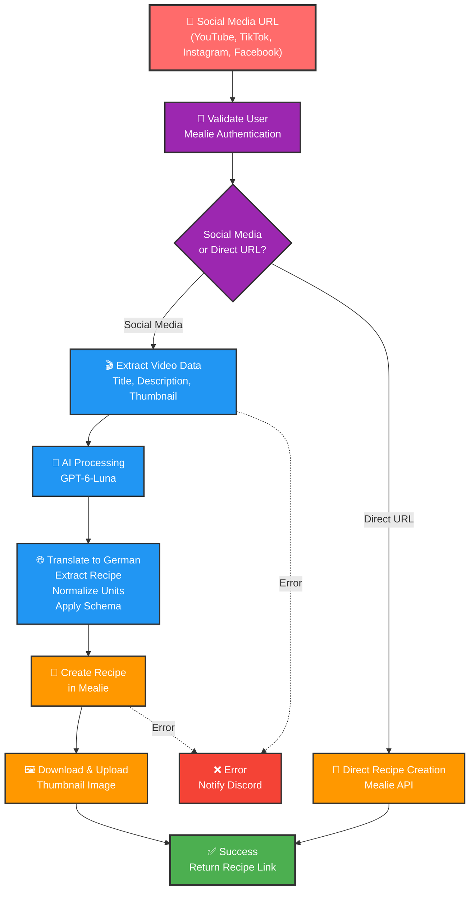

# testing0

Recipe automation stack: Mealie + n8n + YouTube/Instagram/TikTok etc. description API.

Automatically extracts recipes from YouTube, Instagram or TikTok videos etc., translates them to German via AI, and saves them directly into Mealie — including the thumbnail image.

## Services

| Service                       | URL                   |
| ----------------------------- | --------------------- |
| Mealie                        | http://localhost:9925 |
| n8n                           | http://localhost:5678 |
| SocialMediaMetaDownlaoder API | http://localhost:8089 |

## Setup

Optionally add Instagram cookies to avoid 429 errors (Too Many Requests) (Netscape format):

```bash
# Export from browser and place at:
./cookies.txt
```

## Feature

[iOS Shortcu/Kurzbefehl](https://www.icloud.com/shortcuts/7df08a71a14046de8a30ad2b72ba7a96) for easy importing of social media URLs into the mealie via share menu in social media apps (instagram, youtube, tiktok, facebook)

## Run

```bash
docker compose up -d
```

## n8n Workflow

Import `Public-Social Media to Mealie.json` into n8n and configure the following placeholders:

The workflow exposes a webhook (POST). Send a JSON body with a `url` field pointing to a YouTube or Instagram video.


